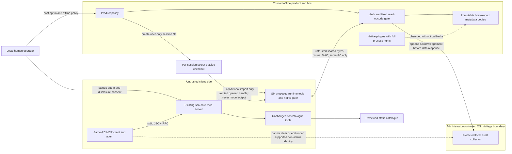

# Design: opt-in local runtime MCP inspection

Status: **steps 3–5 host policy/collector, separate launcher and no-game fixture implemented locally;
touched targets configure/compile, tests NOT RUN by owner speed order**.
See the [acceptance ledger](../runtime-acceptance.md) for separate portable/Windows/manual evidence.
Current task explicitly selects separate `tools/sco-core-mcp-runtime` (placement B),
superseding the historical placement A sections below. Discovery stays unchanged.
Windows effective-identity ACL proof and manual offline acceptance are **NOT VERIFIED**.
Step 3 adds default-off `Platform::runtimeInspection`, atomic product offline
admission/revocation and a bounded protected OS collector; see [runtime-audit.md](../runtime-audit.md).

Historical step-0 decisions (placement A is superseded): The owner
approved placement **A**, an opt-in runtime tool group inside the existing
`tools/sco-core-mcp` stdio server and all eight defaults on **2026-10-12**;
the runtime data-source decision is recorded below and tracked in
[#141](https://github.com/scubamount/sco-core/issues/141). The host IPC/auth endpoint has fixture-only admission;
product startup policy, protected OS audit, adapter packaging and runtime MCP registration remain follow-ups. **Not run in game.**

## Problem and scope

The six existing tools describe a compiler-backed SDK catalogue, not a running
host. `list_services` enumerates catalogue tables; `check_compatibility` explicitly
cannot establish plugin loading, live members or behavior
(`tools/sco-core-mcp/server.py:56-68,313-325`). The current development-only,
stdlib launcher promises no game/host connection (`tools/sco-core-mcp/README.md:3-7`;
`docs/agent-integration.md:3-7`). A plugin author needs a separate observation of
load/refusal/fault state, publication, lifecycle and existing signature resolution.
This is an interface gap, not a measured productivity or game-reliability claim.

The host has those internal facts, but **no existing diagnostics RPC**.
`sco.ipc` offers channel transport, not authenticated inspection endpoints
(`docs/ipc.md:85-97`). New endpoints and safe copied snapshots are necessary.
The existing README distinguishes signature resolution from unperformed gameplay
checks (`README.md:21-24`); diagnostics must never upgrade that evidence.

### Non-goals

- No writes/mutation to game, plugins, settings, capability gates or services;
  no command/raw invocation, reload/unload, process launch/injection, hook or
  patch installation, service-table hand-out, provider pin or scanner rerun.
- No network beyond same-PC local IPC. Specifically **no socket at all**, including
  loopback HTTP, TCP, UDP, WebSocket, `sco.net` or a remote MCP listener.
- No online play, CIG server/account access, anti-cheat interaction or bypass,
  entitlement changes, host-type/network-context forcing or telemetry.
- No remote control, LAN/VPN diagnostics, tunnels, SSH-forwarded stdio, hosted
  agent/cloud-review access to a workstation host. Hosted catalogue discovery
  remains a different use case (`docs/agent-integration.md:74-110`).
- **No gameplay data in v1: metadata only.** No entity/player census, position,
  health, peer roster, proprietary bytes/assets, patterns, addresses, memory read,
  file tail, executable/module dump or SDK/game method execution.
- No native sandbox, crash recovery or safe hot reload promise. A native plugin
  has full process privileges; retained `faulted` providers require restart
  (`docs/plugins.md:76-103`; `sdk/docs/plugin-rules.md:36-60`).

Transport control-plane queues, authentication state, heartbeats, copied snapshots,
bounded log capture and protected audit events are permitted internal changes;
“read-only” is a game/plugin-state promise, not a claim that no control memory or
OS audit storage changes. The broader plugin policy allows private co-presence;
this diagnostics contract does not (`sdk/docs/plugin-rules.md:5-27`).

## Decisions

| Decision | Status | Approved decision / remaining implementation detail |
|---|---|---|
| Placement | **Current task: B (supersedes A)** | Separate default-off `tools/sco-core-mcp-runtime`; original six-tool discovery executable unchanged. |
| v1 observation scope | **Decided 2026-10-12 (owner)** | Host/plugin/service/signature/lifecycle metadata only; no gameplay snapshots. |
| Product ownership and offline admission | **Decided 2026-10-12 (owner)** | Trusted product supplies a default-off developer setting and positive offline verdict; unknown means no channel. Owner must name product, revocation fact and downstream PR owner. |
| IPC/credential identity | **Decided 2026-10-12 (owner)** | Host-owned `sco.diagnostics`, one host and one peer per user/session, versioned layout, per-session secret outside checkout/plugin roots, packaged native peer adapter. Multi-host support requires a separate unique-name decision; no auto-discovery. |
| Audit privilege boundary | **Decided 2026-10-12 (owner)** | Administrator-provisioned local OS collector, supported non-admin client, verified append-only publisher/agent permissions and fail-closed acknowledgement. Elevated/unrestricted same-user agents cannot receive the no-rewrite guarantee. |
| Disclosure | **Decided 2026-10-12 (owner)** | Structured host events only; free-form plugin text separately default off; field minimization and explicit remote-model disclosure consent. Owner may require IDs/version aliases. |
| Limits and retention | **Decided 2026-10-12 (owner)** | Limits below and seven-day administrator-controlled audit rotation; fixture measurements gate rollout. |
| License/package boundary | **Decided 2026-10-12 (owner)** | New diagnostics wire and adapter GPL-3.0-only unless owner grants a reviewed per-file exception. New implementation packaging membership remains to be chosen. This PR's design/test fixtures are repository-only under existing exclusions, not a fifth MIT header. |
| Acceptance ownership | **Decided 2026-10-12 (owner)** | Owner names Windows security-fixture provisioner and manual offline tester; record build/session-scoped fixture, OS-security and manual evidence separately. Until manual acceptance: **not run in game**. |
| Runtime data sources | **Decided 2026-10-12 (owner)** | Both a minimal snapshot published by the Star Citizen game pack and an optional diagnostics SDK plugin for plugin-authored fields. Both off by default, read-only, without personal identifiers, and exposed only through the host diagnostics endpoint; no side channel. Source implementation documented in [diagnostics-publishers.md](diagnostics-publishers.md) ([#141](https://github.com/scubamount/sco-core/issues/141)); source opt-in grants no endpoint admission. |

The eight defaults are approved as written; naming/provisioning, reviewed grants
and package membership explicitly left in their content remain implementation
prerequisites, not pending approval of those defaults. The data-source decision
does not expand the v1 metadata-only scope or the six closed schemas: extra
plugin-authored fields require a separately reviewed versioned contract.
Protocol numbers and schema v1 below remain design contracts, not new exports
or runtime acceptance evidence.

## Historical placement A (superseded by current separate-launcher task)

One client registration allows contract/runtime comparison without embedding MCP
parsing in the game. This convenience must not silently expand the current
server's privileges or blur catalogue/runtime provenance. A client tool-name
allowlist and MCP annotations alone are **insufficient isolation**.

The implementation PR must enforce all of these gates:

1. Proposed `--enable-runtime` or exact `SCO_CORE_MCP_RUNTIME=1`, supplied by the
   local human in startup configuration, enables the group. Unset/`0` means off;
   other environment values are startup errors, never truthy enablement. There is
   no enabling MCP tool, hot toggle, catalogue flag or repository auto-config.
2. **Disabled mode registers nothing runtime-related:** exactly the original six
   definitions remain in `tools/list`, in their existing order with unchanged
   schemas, annotations, result shapes, limits and catalogue provenance. Unknown
   `runtime_*` calls take the existing unknown-tool path. No disabled placeholders.
3. **No runtime import path is loaded in disabled mode.** Parse the opt-in before
   any conditional runtime module import, adapter discovery/loading, IPC attach,
   credential read, worker creation or audit access. Discovery stays stdlib-only;
   no new mandatory dependency, native adapter, credential or install step.
   Test-only schema validation does not enter `server.py`'s import graph.
4. The catalogue option and its loading/validation continue unchanged. Runtime
   registration adds exactly six static definitions to the existing process,
   for twelve total when enabled. Runtime dispatch never consults catalogue
   strings to choose an opcode or function. Catalogue results keep their existing
   provenance; runtime results use the separate `source: runtime` envelope.
5. Server opt-in is not host opt-in. The host must independently pass offline,
   disclosure and protected-audit admission. Enabling plugins or setting
   `gameServices` is not diagnostics authorization. A local six-runtime-name
   allowlist is additional defense in depth, not the gate.
6. Before shipping step 4, **rewrite** the discovery README: its blanket “no host
   connection/no writes” statements become explicit disabled/discovery-mode
   guarantees; document enabled-mode credential read/IPC and host audit writes,
   same-PC-only deployment, separate rate budgets, consent and disable/restart.
   Preserve existing credentials-free catalogue-only launchers and hosted-runner
   instructions. The single proposed-design sentence in this step-0 PR changes
   no current guarantee (`tools/sco-core-mcp/README.md:187-211`).

### Required disabled-mode regression

In a fresh interpreter, install import traps for all future runtime modules and
native adapter loaders; credential/IPC/audit hooks raise if touched. Start the
**actual existing stdio launcher** without the opt-in using its synthetic
catalogue; initialize, list, call each of the six discovery tools, and attempt all
six runtime names. Assert exact old definitions/results/provenance and unknown
runtime calls, zero trap hits, zero runtime entries in `sys.modules`, zero socket,
process, credential or IPC activity. Repeat with runtime files/adapter absent and
with poisoned runtime paths/credentials configured while the enable value is `0`.
Also exercise unset/invalid/exact `1` environment and explicit flag cases, and
require opt-in evaluation before optional imports. No assertions based only on
mock registration or annotations. Run the existing discovery test file alongside
this narrow regression (`tools/sco-core-mcp/test_server.py:1-7`; documented stdio
acceptance seam `tools/sco-core-mcp/test_integration.py:32-49`). This is a future
acceptance requirement, **not coverage already provided by step 0**.

## Six tools: exact JSON contracts

The normative JSON Schema draft 2020-12 document is
[`contract.schema.json`](../../tools/sco-core-mcp/runtime_schema/contract.schema.json).
It contains complete input/output schemas, closed objects at every level, scalar
bounds and all error enums. For tool `T`, `#/$defs/T_input` is its `inputSchema`
and `#/$defs/T_output` its `outputSchema`; the root validates synthetic paired
vectors with fixed tool/opcode/version. These schema definitions are the exact
contracts, not an inference from example responses. No additional fields are
permitted. Unknown fields/version/opcode are refused, not silently ignored.

| Tool | Wire opcode / endpoint | Exact input and output schema JSON pointers | Successful `data` |
|---|---|---|---|
| `runtime_get_host_info` | `0x0100` / `diagnostics.host_info` | `#/$defs/runtime_get_host_info_input`, `#/$defs/runtime_get_host_info_output` | `host_info`: host version, ABI major/minor/table size, known SDK/game-pack/build labels, diagnostics version, readiness, restart flag. |
| `runtime_list_plugins` | `0x0101` / `diagnostics.plugins` | `#/$defs/runtime_list_plugins_input`, `#/$defs/runtime_list_plugins_output` | `plugins`: page of ID/version/kind/manifest-valid/state/reason/load-generation/restart flags, including refused/disabled/faulted entries. |
| `runtime_tail_plugin_log` | `0x0102` / `diagnostics.plugin_log` | `#/$defs/runtime_tail_plugin_log_input`, `#/$defs/runtime_tail_plugin_log_output` | `logs`: structured entries with sequence/time/host-assigned plugin ID/level/origin/message/untrusted marker; gap, redaction, capture and continuation metadata. |
| `runtime_list_service_status` | `0x0103` / `diagnostics.services` | `#/$defs/runtime_list_service_status_input`, `#/$defs/runtime_list_service_status_output` | `services`: name/packed version/owner category+ID/publication-admission status/exposure/known diagnostic table size/reason. |
| `runtime_get_resolution_status` | `0x0104` / `diagnostics.resolution` | `#/$defs/runtime_get_resolution_status_input`, `#/$defs/runtime_get_resolution_status_output` | `resolutions`: row ID/existing state/match count/reason/resolution-generation/known game-build label. |
| `runtime_get_game_status` | `0x0105` / `diagnostics.game_status` | `#/$defs/runtime_get_game_status_input`, `#/$defs/runtime_get_game_status_output` | `game_status`: lifecycle/tick age/offline verdict/requested-built-published service distinction/fixed capability gates/restart flag; **not gameplay state**. |

Inputs: host/game info are closed empty objects `{}`. Plugin list optionally takes
`state`, `cursor`, `limit`; service list `service`, `cursor`, `limit`; resolution
list `row_id`, `cursor`, `limit`. List limit defaults to 25, range 1..50. Tail
requires `plugin_id`, optionally `after_sequence` and `limit` (default 50, 1..100).
No path, address, allocation size, callback or function selector input exists.
Plugin IDs are 1..31 `[a-z0-9_]`; service IDs at most 63 dotted grammar characters;
row IDs at most 128; opaque cursors at most 128 base64url characters. Output
versions/reasons are sanitized and bounded, not automatically trusted text.

All output fields are required, with unknown facts explicitly JSON `null` (or a
schema-defined `unknown` enum), never invented values. Unsigned 64-bit epochs,
generations and sequences are bounded decimal **strings** to avoid JSON client
integer rounding; wire binary values still use u64. Timestamps are monotonic
milliseconds, not wall-clock or model-local time. `observed_ms` and `age_ms` use
one machine clock and JavaScript-safe integer bounds. Overflow ends the session
before reuse; never wrap a generation/sequence into an old valid token.

The result envelope is closed and always contains:

```json
{
  "status": "ok",
  "provenance": {
    "source": "runtime",
    "schema_version": 1,
    "session_id": "0123456789abcdef0123456789abcdef",
    "epoch": "1",
    "generation": "1",
    "observed_ms": 1000,
    "age_ms": 100,
    "host_build": "fixture-host-1",
    "source_sha": "0000000000000000000000000000000000000000"
  },
  "data": {},
  "error": null
}
```

This snippet shows the **common shape**, not a valid per-tool data payload. Complete
synthetic payloads are in [`responses.json`](../../tools/sco-core-mcp/runtime_schema/responses.json),
paired with [`requests.json`](../../tools/sco-core-mcp/runtime_schema/requests.json).
Synthetic coordinates are not actual host execution results. Host coordinates
come from the authenticated host build/session, never from catalogue provenance,
caller strings or a claim that matching labels certify compatibility.

For MCP, put the envelope in `structuredContent`, mirror it exactly as JSON in
one text content item, and set `isError=true` for `unavailable`/`unknown`, false
for observations. Runtime annotations are `readOnlyHint=true`,
`destructiveHint=false`, `openWorldHint=false`, **`idempotentHint=false`** because
successive observations can differ. Existing discovery annotations stay unchanged
(`tools/sco-core-mcp/server.py:33-34,282-285`). No universal `works` field exists.

### Error and observation states

| `status` | `data` / `error` | Meaning and action |
|---|---|---|
| `ok` | Typed data / `null` | Authenticated observation age at most 1000 ms; not evidence of game behavior. Unknown optional facts remain null. |
| `stale` | Typed data / `null` | Cached snapshot older than 1000 ms, only while authenticated link/admission remain valid; measured age required. If fault flags exist, retain them in data. |
| `restart_required` | Typed data / `null` | Fresh metadata reports native fault/restart requirement; never repair/reload or certify recovery. Item flags retain requirements even on stale pages. |
| `unavailable` | `null` / `{code,retry_after_ms}` | No authorized usable observation; no empty-success fallback or cached payload from an invalid session. |
| `unknown` | `null` / `{code,retry_after_ms}` | Authenticated host cannot establish requested metadata; specifically not false/off or a universal failure certification. |

Every tool may return the common refusal codes: `host_unavailable`,
`runtime_disabled`, `auth_failed`, `layout_mismatch`, `session_changed`,
`peer_busy`, `snapshot_busy`, `offline_denied`, `audit_unavailable`, `rate_limited`,
`invalid_request`, `oversize`, `corrupt_frame`, `deadline_expired`.
`unknown_metadata` uses `unknown`. Exact service/row/plugin filters also use
`not_found` for an unknown ID; list cursors use `snapshot_changed`. All other
refusals use `unavailable`; `retry_after_ms` is null unless a bounded wait is
actually known. Unknown tool names remain MCP invalid-parameters errors; malformed
JSON/initialize sequencing remain protocol errors, not fabricated host results.
Unsigned peer errors are never promoted to authenticated host refusals.

### Observation seams and exclusions

These citations refer to immutable baseline
[`cd9a686bda4184f1befbdf0b74b503a1565540dd`](https://github.com/scubamount/sco-core/tree/cd9a686bda4184f1befbdf0b74b503a1565540dd).
All `path:line` references in this document use that revision, not moving PR lines.

| Existing source seam | Required new copy/publication; prohibited shortcut |
|---|---|
| `include/sco_api.h:147-154`; host version storage `src/host/sco_host.cpp:120-126` | Copy host-owned ABI/version metadata at startup; add actual build identity. Do not invoke the SDK table for an agent. Unknown build metadata stays null. |
| `include/sco/plugins.h:118-160`; list lifetime `include/sco/app.h:125-127` | New game-thread immutable copy of known states/valid manifest fields. Never serialize `dir`, author, name, `reloadCopy`, module/self/export pointers, or read mutable list fields from an IPC worker. Invalid manifest IDs receive deterministic session-local safe aliases (`unknown_` plus bounded ordinal), with `manifest_valid=false`; do not leak raw folder names. |
| Plugin log wrapper `src/host/sco_host.cpp:143-164`; current sink `src/sco_log_status.cpp:10-24`; reports `docs/plugins.md:205-207` | New bounded structured capture plus host lifecycle/fault records; current logger is not a historical log endpoint. Do not open/tail `mod.log`. Built-in capture uses host-assigned identity, not plugin-supplied prefixes. |
| Registry `src/api/sco_services.cpp:15-31,57-74,113-145` | New metadata snapshot under the existing registry lock, with bounded withdrawal tombstones/observation history needed for withdrawn status. `QueryService` records a hand-out (`:78-95`): **never call it**. Exposed status is owner-level (`:108-111`), not counted consumer leases. No table dereference, method probe, hand-out or new pin; table size unknown unless explicit trusted diagnostic registration provides it. |
| `include/sco/signatures.h:17-24,32-38,54-64`; startup rule `docs/architecture.md:94-97` | Copy existing row result only after resolution completes; never `ResolveAll`/`Sig`/subprocess scanner. Exclude `at`, patterns, resolver pointers and image bytes/RVAs. |
| `src/app/sco_app.cpp:79-96,195-224`; product configuration `include/sco/app.h:61-99` | New lifecycle/capability summary and trusted product offline verdict. No gameplay methods or inferred authorization from service flags. Close diagnostics before plugin teardown, not merely at the existing later IPC stop. |

Publish immutable snapshots on game-thread startup/tick/lifecycle boundaries.
The worker reads copies only and never triggers a refresh on demand. Registry
copying must respect lock order and be measured; a metadata read must not change
service withdrawal, plugin state, capabilities or callbacks. Chunk large copies
across ticks and commit one complete generation atomically; partial construction
is not a complete inventory. No new field or reordering in the frozen `sco_api`.

Lists sort by stable safe ID with a stable ordinal for ties. Host-generated opaque
cursor tokens bind session, epoch, tool, exact filter, generation and next index
in a bounded host token table (64 tokens, 60-second expiry). Never accept paths,
pointers or unchecked indices encoded by the peer. Keep at most two completed
snapshots per tool; if the referenced snapshot expired, return `snapshot_changed`
without silently restarting page one. `has_more` iff `next_cursor` is non-null;
`truncated=true` means a host cap prevented a complete inventory even after all
pages. No declared total without a complete counted snapshot. Log sequence is
session-global; resume tokens cannot cross sessions, redaction/retention losses
are counted, and `first_available_sequence`/`dropped_count` expose gaps. Tail
starts after opt-in only. `next_sequence` is the last considered sequence (including
withheld records), so retrying does not repeatedly disclose a redaction gap.

## Proposed host endpoint over existing `sco.ipc`

### Mapping and versioned layout

Host owns `Local\\SCO_sco.diagnostics`; native peer opens only, never creates,
repairs or initializes it. Existing generic creation validates a plugin handle
(`src/ipc/ipc.cpp:141-174`), so add a **host-only** creation path using the permanent
host owner (`include/sco/host.h:44-66`), existing name construction/security/quota
machinery and geometry checks; never cast `HostOwner` into `sco_plugin*` or give
plugins a reserved-name escape. Existing Windows mapping ACL/owner/size checks
are source seams, not proof of the new endpoint (`src/ipc/shm_win.cpp:36-96`).

Proposed layout ID `0x31444753` (little-endian bytes `SGD1`), layout version **1**,
diagnostics schema/framing version **1**, mapping size **262144 bytes**. Reuse
`SC_IPC_VERSION=1`, not a modified generic wire. Little-endian, no pointers or
platform `size_t`; explicit fields/offset pins in the implementation PR.

| Offset | Bytes | Region |
|---|---:|---|
| 0 | 64 | Unchanged `sc_ipc_hdr`: transport version, epoch, heartbeat, layout, state. |
| 64 | 64 | Diagnostics descriptor: u32 magic `0x31444753` at +0; u16 version 1 at +4; u16 descriptor-size 64 at +6; session ID 16 bytes at +8; u64 request-ring offset 128 at +24; u64 response-ring offset 33088 at +32; u32 maximum request-record 4096 at +40; u32 maximum response-record 65536 at +44; u8 reserved[16] zero at +48. |
| 128 | 192 + 32768 | Request SPSC ring, `SC_IPC_FROM_PEER`; header then byte capacity. |
| 33088 | 192 + 131072 | Response SPSC ring, `SC_IPC_TO_PEER`; capacity can hold the largest record plus its transport header/padding. |
| 164352 | 97792 | Reserved zero region; no bulk data or executable payload. |

Geometry is fixed independently of descriptor claims. Verify OS-reported extent,
transport header, complete descriptor, direction, ring capacity/epoch, non-overlap,
zero reserved fields and versions before using cached local views. Do not trust
mutable shared geometry a second time. Existing wire pins/validation/ring framing:
`include/sc_ipc.h:85-112,116-192,326-348,473-499,511-590`;
`docs/ipc.md:23-30,60-67`. PIDs are informational, not auth, and never reach the
model. Future heartbeat values are corrupt diagnostics input, not a fresh link;
the generic `sc_ipc_age` alone caps future ages at zero (`include/sc_ipc.h:377-396`).

One authenticated peer, one outstanding read, bounded queue of eight records.
A user-only local named peer-lease mutex, verified by opened handle and acquired
without waiting by the native adapter, prevents conforming clients from racing
SPSC counters. Host authentication also reserves exactly one connection; another
client gets `peer_busy` **before ring use**, never shares an existing producer.
The host-only lease mechanism is new work, not supplied by the generic ring.
A hostile same-user process can ignore the mutex and corrupt memory: fail closed,
bound work, do not claim availability against it. No auto-attach to another host.

### Fixed framing, opcodes and mutual authentication

Inside `sc_ipc_rec`, reserve record type 1 for a diagnostics frame; every other
non-pad type is refused. A frame has a fixed **72-byte header**, exact UTF-8 JSON
payload and trailing **32-byte HMAC-SHA256**; record limit includes both. Header:

| Offset | Field |
|---|---|
| 0 | u32 magic `0x31444753` |
| 4 | u16 diagnostics framing version 1 |
| 6 | u16 opcode |
| 8 | session ID, 16 bytes |
| 24 | u64 IPC epoch |
| 32 | u64 direction-local sequence |
| 40 | request ID, 16 random bytes (echo in correlated response) |
| 56 | u32 payload byte length |
| 60 | u8 direction (1 peer-to-host, 2 host-to-peer) |
| 61 | u8 reserved[3] zero |
| 64 | u64 absolute monotonic request deadline ms; response echoes it |

Length must equal `72 + payload_length + 32`, checked without overflow **before**
allocation/copy. Header and exact payload bytes, not a reserialized object, are
MACed with domain prefix ASCII `sco.diagnostics.v1\0`. Reject invalid UTF-8,
duplicate JSON keys, non-finite numbers, excessive nesting (maximum 16), unknown
fields/opcodes/version and trailing bytes. Authenticated responses carry the same
read opcode and request ID; never accept mismatched unsolicited results.

| Opcode | Direction / role | Exact JSON payload keys |
|---|---|---|
| `0x0001` HELLO | Peer -> host; MAC with session file key K | `client_nonce`: 64 lowercase hex chars; `expected_host_build`: string <=128 or null. |
| `0x0002` CHALLENGE | Host -> peer; MAC with K | `client_nonce`, `host_nonce`: 64 lowercase hex each; `host_build`: sanitized string <=128 or null. |
| `0x0003` FINISH | Peer -> host; MAC with derived directional key | `client_nonce`, `host_nonce` (echo exact transcript). |
| `0x0004` READY | Host -> peer; MAC with derived directional key | `client_nonce`, `host_nonce` (echo exact transcript). |
| `0x0005` CLOSE | Either; authenticated connection only | `reason`: `stopping`, `revoked`, `deadline`, `corrupt`, or `client_exit`. |
| `0x0100`..`0x0105` | Authenticated reads/responses | Exactly the six tool input/output schemas above. |

Control objects are closed. Nonces are 32 random bytes each; zero-length and
repeated nonces within the session are refused. Key derivation uses
`HMAC-SHA256(K, label || session_id || LE64(epoch) || client_nonce || host_nonce)`
with labels `sco.diagnostics.v1.peer\0` and `sco.diagnostics.v1.host\0`.
HELLO/CHALLENGE bind the expected host identity, session, epoch and both nonces;
FINISH/READY prove the fresh shared transcript. Both sides verify MACs in constant
time; no observation is released before READY and protected-audit admission.
Handshake deadline is two seconds. Bind framing/layout/schema versions in the
transcript (framing version in header; layout/schema are fixed to v1 and refused
otherwise). HELLO/CHALLENGE use sequence 0 and are accepted only against a fresh
client nonce and the one pending handshake; previously used client nonces are
refused before a new challenge. Post-derivation counters start at 1 (FINISH/READY),
so the first read/response uses 2. Each receiver then accepts only the exact next
sequence under its directional key; duplicates, gaps, overflow, wrong direction,
epoch/session/request ID are refusals before dispatch. Fresh keys never reuse a
nonce transcript. Remember used client nonces within bounded control admission
for the entire host session (maximum 4096); exhaustion refuses further attachment
until operator restarts, never evicts replay protection early.

Credential file: host creates a fresh random **32-byte K** and 16-byte session ID
on every start/re-enable; closed JSON object with `credential_version=1`,
`session_id` (32 lowercase hex), `secret` (64 lowercase hex), `mapping_name`
(exact fixed name), `layout_id=826558291`, `layout_version=1`, `epoch` (u64 decimal
string), `host_build` (sanitized <=128 or null). Stored outside checkout/plugin
roots in an operator-selected local runtime directory, never discovered by a
tool argument. User-only Windows owner/DACL; POSIX fixture directory 0700/file
0600. Verify ownership/type/perms on opened handles, refuse symlinks/reparse
substitution and inherited broad access, atomic exclusive creation, no secret in
argv/env/header/log/results/catalogue. Reject leftover mismatched files after a
crash; remove on normal stop, rotate on every new admission. Configure a
**credential path**, not secret value, at startup; default disabled mode ignores it.

Possession proves local-session access, not executable/model identity. Mapping
ACLs/HMAC do not sandbox same-user malware or encrypt shared memory. No reuse of
`sco.net` keys, peer session or network handshake. An attacker who steals K is a
credential-holder; the host still restricts every request to its exact read list.
The dispatcher has no generic invoke/raw/script/function/address forwarding,
plugin lifecycle route or SDK service selector, even for authenticated peers.

### Limits and scheduling

Independent host and enabled-server enforcement; discovery limits remain unchanged
(`tools/sco-core-mcp/server.py:18-22,287-294`). The owner approved the new values below on 2026-10-12; rollout still requires fixture measurements.

| Boundary | Approved v1 limit (fixture-gated) |
|---|---|
| MCP runtime input / output | 64 KiB input; 256 KiB whole runtime MCP response (including duplicated text/structured envelope). |
| IPC mapping / complete frame | 256 KiB mapping; 4096-byte request / 65536-byte response, including 104 bytes of header+MAC. |
| Host reads | 60 per 60 seconds, host-global; burst 5; one peer/outstanding request; <=8 queued records. |
| Control | Separate 5 authentication attempts per 60 seconds; independently bounded corrupt-ring work (<=8 records per worker iteration). |
| Lists / cached inventories | 25 default / 50 maximum per page; <=1024 entries per tool snapshot, explicit truncated flag; <=2 generations retained. |
| Cursors | <=128 ASCII bytes, <=64 live tokens, 60-second expiry, session/tool/filter/generation-bound. |
| Capture / log tail | 1 MiB total retained capture; <=512 **UTF-8 bytes** per message; <=100 entries / 32 KiB serialized tail data; whole-response limit also applies. |
| Refresh / heartbeat / deadlines | <=1 background refresh per second; >1000 ms snapshot is stale; >5000 ms heartbeat age invalidates link; peer beats at least once/sec; 2000 ms request/handshake deadline. |
| Game-thread snapshot work | Target <=1 ms/tick, <=4 copy work units/tick, atomic completed generation. Over-budget work skips/marks stale; never blocks for audit/disk. |
| Protected audit | Seven days, bounded OS collector rotation controlled by administrator; document capacity and overflow acceptance before deployment. |

Wire/header/ring operations avoid waits, but existing host-service locks are
**not** a bounded-latency guarantee (`docs/ipc.md:97`). Snapshot/lock/tick budgets
need fixture measurements and Windows offline acceptance, not a documentation
claim. Audit acknowledgement occurs on the diagnostics worker within deadline.
Do not block the game on collector/storage. Capture overwrite/rate refusal changes
no game/plugin state. Native adapter uses the pinned `sc_ipc.h` atomics and geometry
checks, never hand-rolled Python atomics (`include/sc_ipc.h:37-59,194-254`).
Package/select an audited adapter by explicit trusted path/hash; no runtime compile,
download, `PATH` search or arbitrary DLL loading. Adapter absent with runtime
opt-in is a sanitized startup error; absent in disabled mode is irrelevant.

## Opt-in, offline admission and no-host behavior

Proposed host option on `Platform` plus product `runtime_inspection=off` developer
setting is **new work**; no offline/diagnostics field exists in the current
`Platform` (`include/sco/app.h:61-100`). Require positive trusted-product offline
authorization before channel, secret or capture creation. Unknown/online/disallowed
means disabled; do not contact servers, interrogate/bypass anti-cheat or infer
posture from signatures, plugin enablement or `gameServices`. Product ownership
and revocation facts must be named before implementation rollout, as required
by the approved default. If trustworthy policy
cannot be supplied, leave inspection unavailable.

Revocation closes admission/mapping before plugin teardown, invalidates keys,
queued requests and cached observations, and drops captures. No agent tool can
enable/reopen it. Human enabling host plus human enabling server are two gates;
explicit model-disclosure consent is an additional policy prerequisite, not an
implicit consequence of IPC opt-in.

Enabled server with no credential/mapping returns `unavailable/host_unavailable`;
all unattested session/build/time provenance is null. Use `runtime_disabled` only
when known locally. Missing link is not proof of why the host is absent. Never
launch/inject, create a peer mapping, read arbitrary files/logs, or synthesize an
empty successful list. Auth/layout/peer-busy failures stay distinct.

`SC_IPC_GONE`, stop, corrupt frames, heartbeat expiry or admission loss invalidate
attachments and cached payloads. `SC_IPC_EPOCH`/session change abort the old call
with `session_changed`; re-read/verify a fresh credential and handshake on the
**next explicitly requested read**, never replay the old call into a new session.
Bound `SC_IPC_BUSY` retries by the same deadline, then `snapshot_busy`. A live
heartbeat with an old snapshot returns measured `stale`, not a fresh empty list.
Existing epoch/closure behavior is transport evidence only
(`include/sc_ipc.h:351-396`; `docs/ipc.md:55-58`).

## Redaction and protected audit

Field allowlisting precedes any string redaction. Omit user names/SIDs/PIDs,
personal emails, author/display-name fields, absolute paths, command lines,
secrets/MACs, network identities, game bytes and pointer/RVA values. Sanitize IDs,
versions, reasons and cursor diagnostics too. Use fixed host-generated reason
codes wherever possible; known roots become `<plugin-root>`, unidentified
path-like or uncertain content is withheld. Strip controls safely and truncate
UTF-8 on codepoint boundaries; never return raw OS exception text.

Default logs are structured host lifecycle/fault events. Free-form plugin text
requires separate default-off human consent and may still disclose personal data
or instructions despite pattern filters; withhold uncertainty and count
`redacted_count`. Every log entry is `untrusted_content=true`, including
host-rendered strings. Neither authenticated bytes nor read-only annotations
make prose instructions. Local clients may send results to remote model providers:
obtain explicit disclosure consent; add no telemetry. The current guide already
warns about that disclosure distinction (`docs/agent-integration.md:126-136`).

Audit every admitted/refused read, authentication failure, open/close, rate/audit
failure: session/request correlation, opcode, sanitized filter IDs, outcome,
time, response bytes and schema/build identity only; **no secret, MAC, raw payload
or log message**. Aggregate denial floods with explicit counts. A successful data
response requires acknowledgement that its event was accepted into the protected
sink, not just queued in writable process memory.

A same-user checkout file, append mode or hash chain cannot meet “agent cannot
rewrite.” Proposed Windows deployment is an administrator-provisioned **local OS
collector/channel** with publisher-only host access and a supported non-admin
agent identity denied clear/edit/retention/disable. Human provisioning is not an
MCP tool. Prove actual effective-identity permissions from another fixture process;
configuration text/fake collector tests are insufficient. Until that proof, or if
acknowledgement times out/is full, reads fail closed with `audit_unavailable`.
An ordinary log may explain startup refusal but is not the protected audit sink.

**Honest limit:** an elevated agent/administrator, compromised host/native plugin
or unrestricted same-user agent with elevation can defeat this guarantee.
Same-user native code can steal K/corrupt the mapping or forge additional publisher
events even where collector history is protected. Separate security identities
are needed for stronger origin/agent isolation. Do not market hash chaining or a
bearer token as equivalent. Collector loss disables diagnostics, not gameplay;
administrator rotation means finite, not permanent, retention.

## Threat model and trust boundaries



| Threat | Mitigation / residual risk |
|---|---|
| Accidental privilege expansion in existing discovery | Absent registration and import graph while disabled; poisoned-path/adapter-absent stdio regression; mode-specific README and distinct provenance. Client allowlist is not isolation. |
| Hostile direct IPC peer bypasses MCP | Host auth + closed fixed-opcode/schema dispatcher; raw-peer mutation tests. No arbitrary invoke or SDK table export. |
| Spoofing/replay/session confusion | User-only opened-handle credential checks, mutual fresh-nonce handshake, direction/session/epoch/sequence/ID/length MAC binding; no silent cross-session replay. Same-user secret theft remains possible. |
| Shared-memory corruption/resource exhaustion | Cached geometry, literal layout pins, length/rate/deadline/copy bounds, one conforming SPSC peer; hostile same-user availability is not guaranteed. |
| Read has hidden side effects | Copied snapshots; zero QueryService/callback/game-method probes and before/after fixture state proof. Diagnostic/audit control changes explicitly allowed. |
| Log/manifest prompt injection and sensitive disclosure | Field minimization, withheld uncertain text, untrusted markers, separate log/model consent; no regex claim of perfect redaction. |
| Audit rewrite | Actual administrator-owned collector ACL boundary tested under effective agent identity; fail closed, explicit privileged/same-user limitations. |
| Online or remote use | Two human opt-ins plus trusted positive offline admission; no socket/listener/tunnel/remote deploy; revoke before teardown. Product verdict is policy assertion, not anti-cheat detection. |
| Compromised native host/plugin or administrator | Outside integrity/confidentiality guarantee; native full rights documented, no recovery or sandbox claim. |

## Phased PR plan and acceptance

All phases remain game-neutral/buildable with `SCO_GAME_SC=OFF`; product adapters
supply optional game-pack metadata, not game types in the kernel. Each follow-up
needs its named narrow regression and documentation, not a full-suite proxy.
Fixtures contain only project-authored synthetic IDs/data. CI never downloads,
needs, starts or injects a game or reads proprietary files.

| Step | One PR / exit condition | Narrow test and required documentation |
|---|---|---|
| **0 (this PR)** | Placement A and eight defaults approved by the owner on 2026-10-12; runtime data-source decision tracked in #141. No runtime implementation. | Synthetic schema/golden vectors using existing stdlib schema validator (`tools/ip_audit.py:658-728`); refuse unknown fields/opcode/version and oversized bounds. Add SECURITY/design links/changelog/provenance; current discovery tests unchanged. No live peer, crypto, ACL or audit proof claimed. |
| **1: copied host snapshots** | **Implemented by this PR (`runtime/snapshots`).** Game-thread immutable plugin/lifecycle/signature copies, metadata registry copy and bounded keyed capture; no external channel. | `test_runtime_diagnostics_snapshot` fixture: all states, invalid manifests, withdrawal/exposure/restart/log gaps, redaction, generation pages, physically short trusted tables. Zero QueryService/new hand-outs, plugin callbacks, SDK/game methods and unchanged plugin/capability state. Update architecture/plugins/log privacy docs; frozen ABI untouched. |
| **2: host IPC/auth gate** | **Implemented locally (`r1/rt-ipc`), fixture-only admission.** Host-only channel path, versioned geometry/frames, secrets, singleton lease, mutual MAC and strict read dispatcher; default off. Fixture audit interface only. | `test_runtime_diagnostics_ipc` real transport + hostile peer: malformed geometry/counters/lengths/UTF-8, forged responses, credentials/replay/epoch/deadline, second peer, authenticated raw/mutation/reload/network opcodes and zero side-effect counters. Independent literal frame/layout/ABI pins; update IPC and explicit no-net/key-reuse docs; record wire licence/package ownership. |
| **3: audit and product policy** | Collector acknowledgement/ACL adapter, default-off host integration, positive offline admission, revocation ordering. Downstream consumer PR is separately authorized. | `test_runtime_diagnostics_policy`: off/unknown/online, pending-read revocation, audit full/timeout/unavailable, rate aggregation, timing/caps, stop-before-teardown. Dedicated Windows no-game process checks token/mapping/collector permissions as intended identities. Update SECURITY, plugin rules, install/disable/retention docs; human provisions collector. |
| **4: separate runtime launcher** | Implemented locally: pinned native open-only peer, exactly six closed schemas, explicit six-name startup allowlist and disclosure consent. Discovery executable unchanged. | New `tools/sco-core-mcp-runtime/test_server.py`; syntax compiled, tests NOT RUN. Runtime process advertises zero tools off and six on; discovery remains six. No socket/subprocess/game operation in production launcher. |
| **5: fixture then human acceptance** | Implemented no-game fixture target/harness connecting real dispatcher/mapping/native peer/actual stdio launcher. Defaults remain off. | `test_runtime_diagnostics_integration` compiled, NOT RUN. Synthetic audit is not OS privilege proof. Windows effective-identity collector/mapping proof and manual offline/game acceptance remain NOT VERIFIED. See separate acceptance ledger; game evidence ledger unchanged. |

Current useful precedents are the synthetic discovery stdio tests and no-game IPC
fixture (`tools/sco-core-mcp/test_server.py:1-7`; `tests/test_ipc.cpp:1-5`), not
coverage of proposed runtime admission. Step 0's vectors test schema contracts
only. Future literal binary/MAC vectors must come from independently specified
bytes and execute against the actual native implementation, not expectations
computed from its own header.

### Step-0 checks

```sh
python3 tools/sco-core-mcp/test_runtime_schema.py
python3 tools/sco-core-mcp/test_server.py
```

The schema test resolves local references and reuses the repository's stdlib
validator; no `jsonschema` install or new dependency. It imports no runtime code.
The discovery server and existing test code are not edited. Check new relative
document links and cited line ranges against the immutable baseline. These
checks do not establish cryptography, OS security, real-host IPC, performance,
Windows runtime or gameplay acceptance.

## Licence and provenance

Project-authored design, schema and synthetic vectors use GPL-3.0-only and remain
repository-only under `sdk/components.json:57-60`'s existing MCP exclusion.
`docs/legal/provenance.json` records the new path scopes and generated REUSE
mapping. No proprietary extracts or third-party implementation are introduced.
Existing MIT `sc_ipc.h` is reused under its own grant (`include/sc_ipc.h:1-25`);
that grant covers only the four named headers, not a new diagnostics wire/adapter
(`IP_POLICY.md:9-20`). Owner must resolve future per-file grants and package
membership before implementation distribution. Provenance and artifact policy
remain `IP_POLICY.md:29-46,59-74`; no release, repository setting or plugin licence
change is authorized by this design. Security reporting: [SECURITY.md](../../SECURITY.md).
